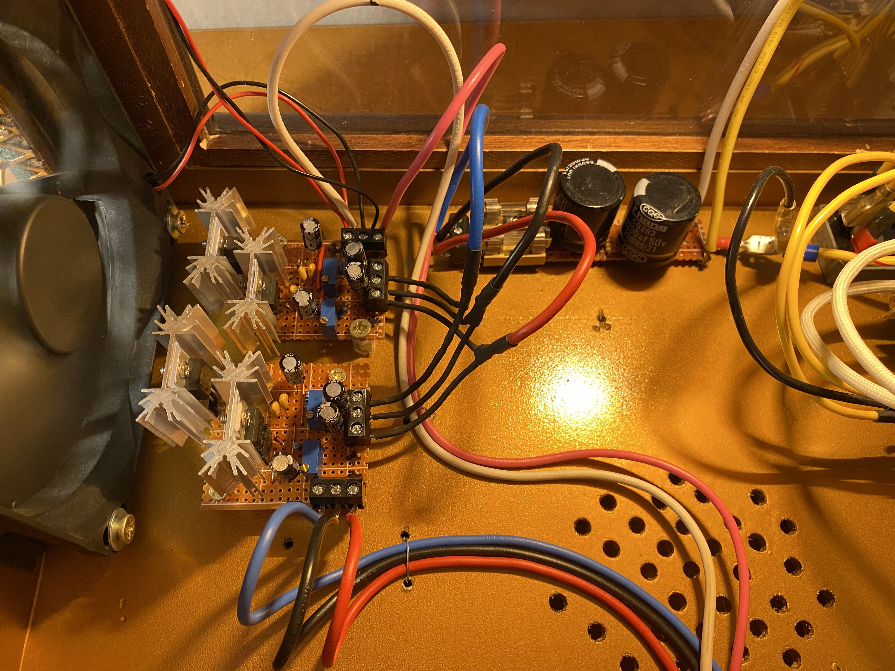
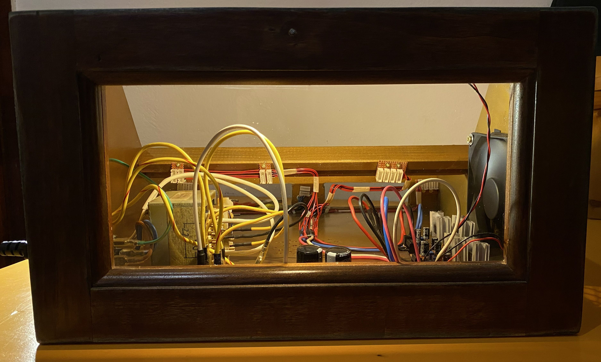

Linear regulated ±15 V and ±12 V rails from a centre-tapped transformer. Built following Eddy's article; below are the parts I used and what is worth knowing before building one.

## Parts

| | |
|---|---|
| Transformer | Samsung MAX-445, 110/220 V primary, 120–130 VA. The 17-0-17 V winding is used. |
| Rectifier | KBPC3510 bridge (35 A, 1000 V) |
| Smoothing | One large electrolytic per rail |
| Protection | 2.5 A slow-blow fuse on the + and − lines, after the smoothing caps. Each line feeds two regulators (the ±15 V and the ±12 V board), hence a rating above a single regulator's 1.5 A. |
| Regulators | LM317 for +12 V / +15 V, LM337 for −12 V / −15 V |
| Regulator boards | Two identical boards (one ±15 V, one ±12 V), outputs set with trimmers |

The transformer is oversized on purpose: it can feed a second rack later. I assume at most ~100 mA per module.

*Regulator boards: ±15 V in front, ±12 V behind.*

## Distribution

Stripboard bus boards connected in a tree with thick, colour-coded stranded wire. Each bus board feeds a small group of modules.

## Build notes

- **Heatsinks:** one big heatsink per regulator, and they must never touch each other (the regulators sit on different rails).
- **Tin the copper strips** that carry current (under the boards).
- **Fan** in front of the regulators, blowing warm air out of the case.
- **Mains:** fuse on the primary, earth every exposed metal part, strain relief on the cable, transformer firmly mounted.

## Case

The rack is an old wardrobe drawer. The glass back is the former drawer front, so the inside is visible, and there is LED lighting inside for debugging.

*Empty case seen through the glass: PSU, power bus and fan.*
