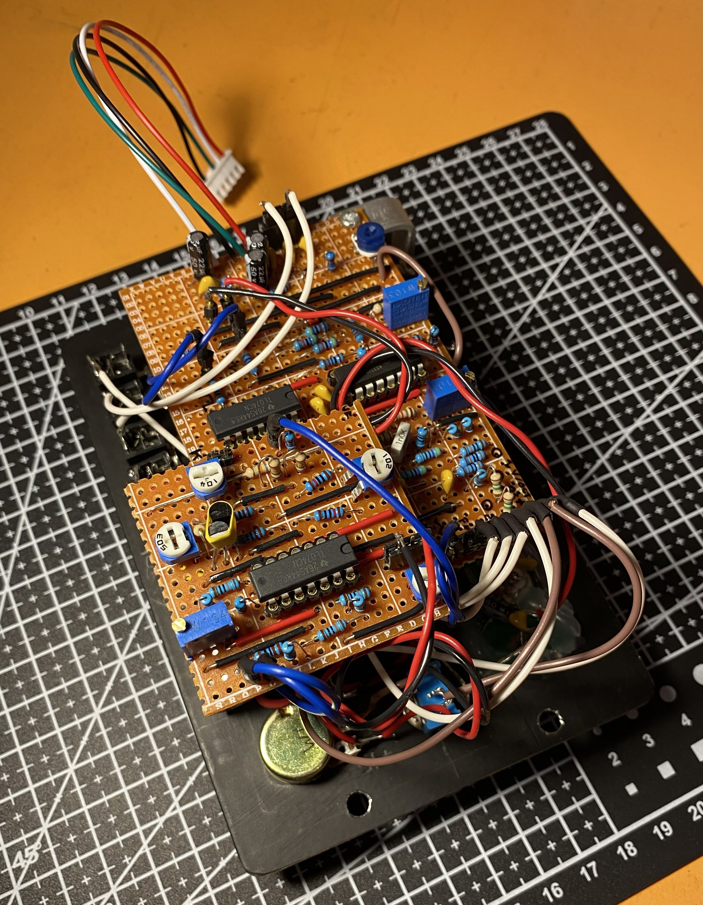
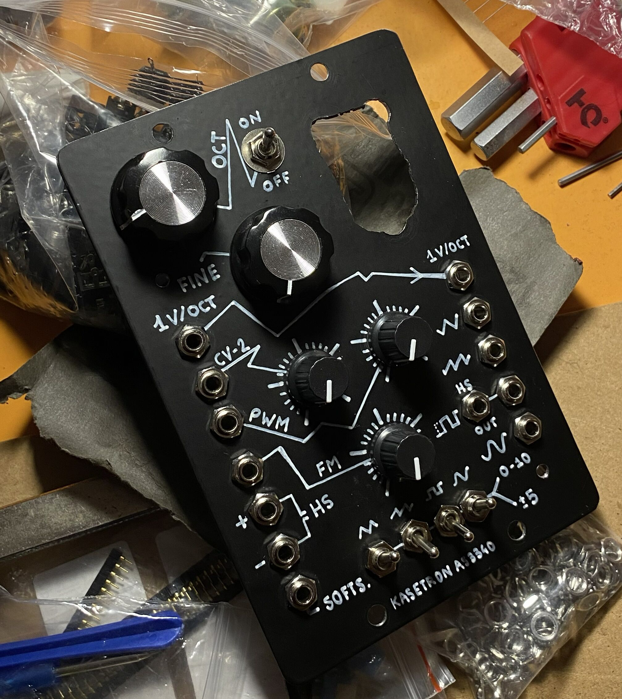

VCO around the AS3340 (a CEM3340 reissue) with standard 1 V/oct tracking. Powered from ±15 V, tested with an Arturia KeyStep 32 as CV source.

**Inputs:** 1 V/oct, CV2 and FM (both with attenuator), external PWM (plus an internal PWM pot), soft sync, hard sync.
**Controls:** octave, fine tune, PWM.
**Outputs:** square, sawtooth, triangle, sine, hard-sync out, 1 V/oct pass-through.

## My modifications

**1. AC / DC switch on every output.** DC mode is 0–10 V (for CV use), AC mode is about ±5 V centred (for audio).
AC is done with 22 µF electrolytics on the offset switches for triangle and sawtooth. The sine comes from the AC triangle, so it is natively AC; its DC version and the AC square use an opamp offset stage.
Together with the input impedance of whatever is patched in, each capacitor is a high-pass filter (corner = 1/(2πRC); with 100 k that is about 0.07 Hz for 22 µF, 1.6 Hz for 1 µF). Even so, the AC saw and triangle distort at very low frequencies: **use DC mode when running the VCO as an LFO.**

**2. Built-in tuner.** A small digital tuner sits behind the panel, visible through a window, with its own supply and signal tap (see schematic).

**3. Sine output.** Triangle-to-sine shaper (2N3904 pair; symmetry, distortion and offset trimmers) on a separate stripboard, plugged onto the main one with long pins.

## Notes

- 22 µF + 100 nF between each rail and ground, with the 100 nF close to the chips.
- The panel is cut from old metal bookshelf brackets, styled after Look Mum No Computer.

