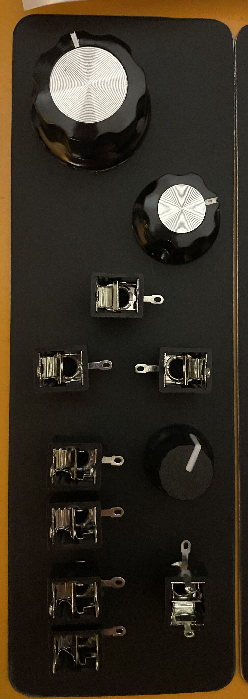

12 dB/oct Sallen-Key filter, lowpass or highpass, with self-oscillating resonance. LM13700 OTAs and a TL074, on ±12 V or ±15 V.

*Panel test-fit: three knobs and eight jacks placed, not mounted.*

## Notes from the article

- **Input level:** it prefers about ±5 V. Hot signals (such as a 0–10 V square) make it misbehave and bury the resonance. Use an input attenuator, or a 470 nF–1 µF cap to block DC.
- **Cutoff pot:** it has the full supply across it (24 V), so don't use a very low value, and double-check the rail connections before powering up: wrong wiring has burned pots.
- Use film, polystyrene or silver mica for the two 1 nF filter caps, not ceramic.
- Cut all the strips under the ICs. The toggle labels on the panel are inverted relative to the wiring diagram.
- In HP mode the cutoff pot only works over about the first half of its travel. The 6 dB switch works in LP only.
- Whistling at high resonance with no input is normal. Self-oscillation can go sub-audible, which is hard on bass speakers.
- 1 V/oct tracking is only approximate (trimming the pitch input resistor to about 82 k helped one builder).
- The BOM numbering doesn't match Rene Schmitz's schematic, and the page has none: use his original.
